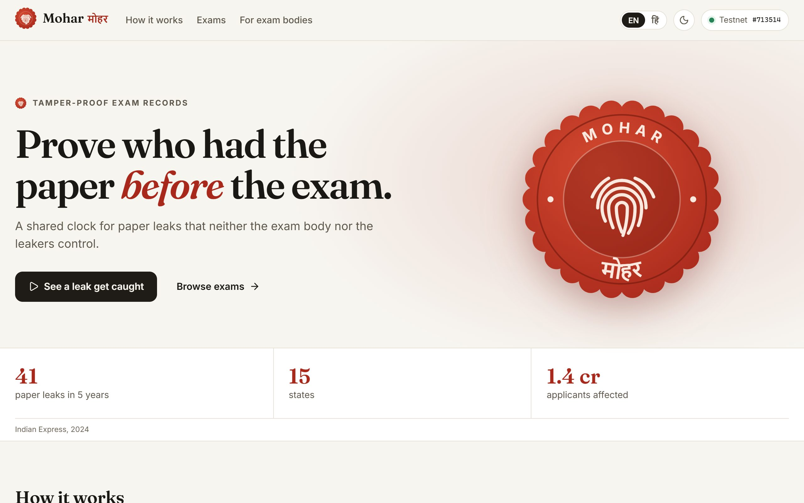
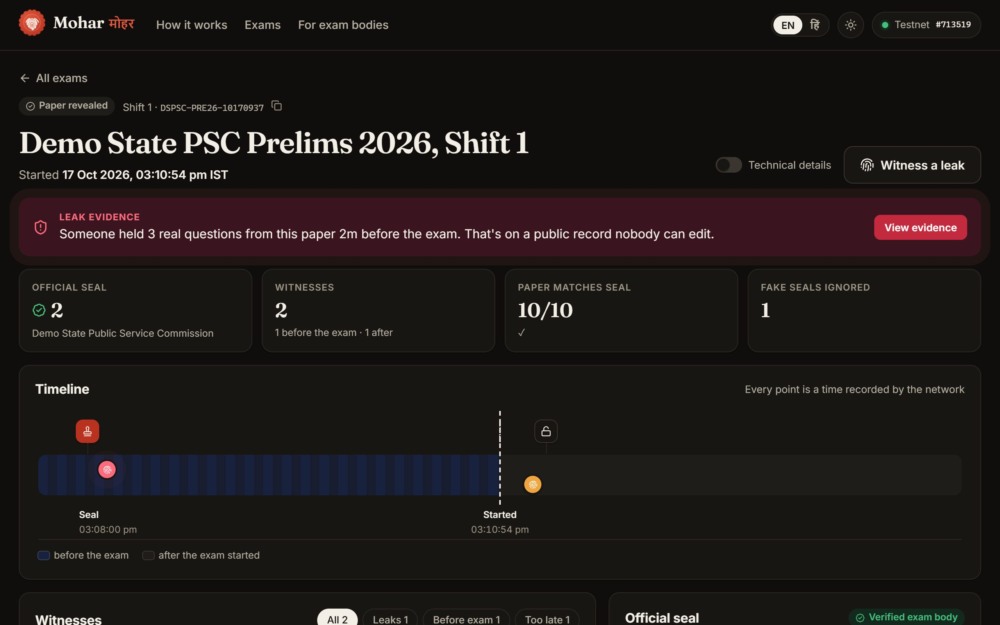
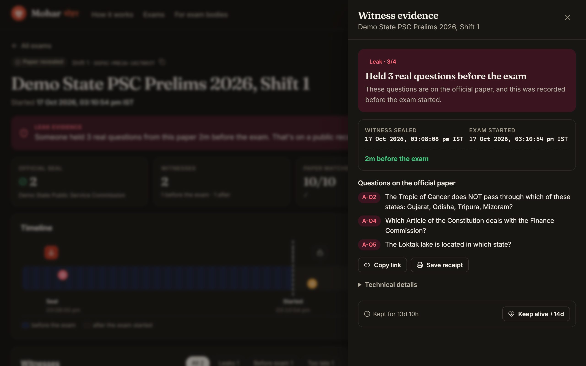
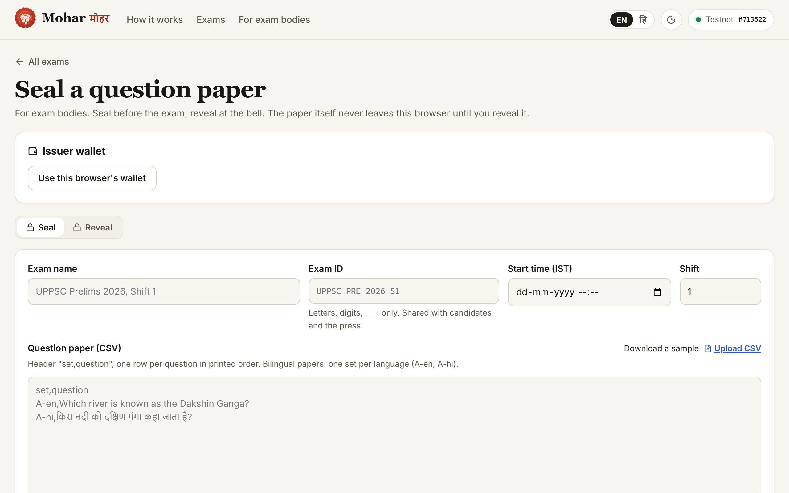
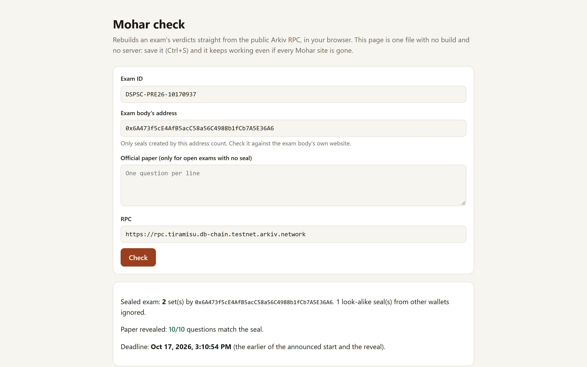
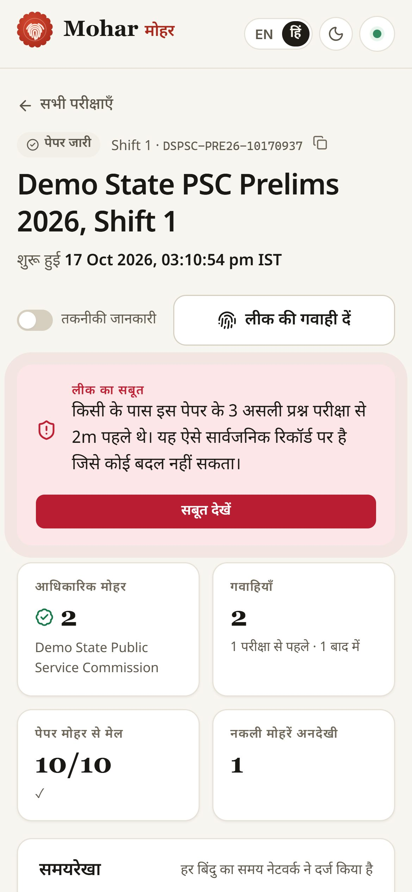

# Mohar (मोहर)

[](https://github.com/vidit-16/mohar/actions/workflows/ci.yml) [](https://github.com/vidit-16/mohar/actions/workflows/codeql.yml) [](https://vidit-16.github.io/mohar/) [](LICENSE)

Prove who had the exam paper before the exam. Built on [Arkiv](https://arkiv.network).

**Live:** https://mohar-in.vercel.app (reading needs no wallet). Hit **"See a leak get caught"** for a 2-minute guided run.

**Backup:** https://vidit-16.github.io/mohar/ is the same app as a static copy on GitHub Pages, reading Arkiv directly. If the main site is ever down or blocked, the evidence is still one link away.

<p align="center"></p>

| Leak caught on the exam page | The evidence for one witness |
|---|---|
|  |  |
| **Exam bodies seal a paper from a CSV** | **One-file checker, no site needed** |
|  |  |

<p align="center"></p>

## Why I built this

Paper leaks are basically a recurring event in India now. The Indian Express counted 41 recruitment exam leaks across 15 states in five years, hitting around 1.4 crore applicants. Every time it happens, the argument ends up being about *time*: did this "leaked paper" on Telegram exist before the exam, or did someone make it after?

In the NEET-UG 2024 hearings, NTA told the Supreme Court that the Telegram video petitioners relied on had a manipulated timestamp. Maybe it did, maybe it didn't. Nobody could prove it either way, because the only clocks around were screenshots and the exam body's own servers. And the exam body is the one being accused.

Mohar puts that clock somewhere neither side controls.

## How it works

1. **Seal.** Before the exam, the exam body writes `sha256(salt | question)` for every question. The record is `readonly` and its ownership goes to `0x…dEaD` in the same transaction, so nobody can edit or delete it later, not even the exam body.
2. **Witness.** Got a "leaked paper" the night before? Paste it in. Your browser hashes each question and writes only the hashes, from a throwaway wallet. The text never leaves your phone.
3. **Reveal.** At the exam, the exam body publishes every set's salts and questions in one transaction.
4. **Verdict.** The page checks, with no backend:
   - Does the revealed paper match what was sealed?
   - Which witnesses held real questions *before* the exam? Time comes from the block, not from anyone's claim.
   - Which "official" seals were forged by other wallets? They're ignored, since trust comes from `$creator`.

**It works for real exams today, without the exam body.** Exam bodies aren't going to adopt this overnight, so anyone can add an *open exam* (name + start time from the official notice). Aspirants seal witnesses against it right away, and once the official paper is published, anyone pastes it in and every witness gets checked on their own device.

It cuts both ways, which I like. An aspirant gets evidence that can't be waved away. An exam body gets an easy way to kill fake leak rumours: no pre-exam seal, no proof.

The UI is in English and Hindi, and the guided tour can narrate in either.

## Why Arkiv

- **Postgres or the exam body's own API:** the operator controls the rows and the timestamps, and the operator is the one accused.
- **IPFS:** content addressing, but no trusted time and no way to ask "every witness for exam X".
- **A subgraph:** needs a contract and someone running an indexer.
- **OpenTimestamps or a plain contract:** honestly, these give you a timestamp more cheaply. What they don't give is a queryable index scoped to one issuer, different lifetimes per record type, anyone being able to keep evidence alive, and a live feed, all without me running a server.

What Mohar actually depends on: `$creator` can't change, block time is set by the chain, and anyone can read everything over public JSON-RPC. If this site gets blocked, the evidence doesn't: every exam page lists raw `curl` commands, and [`mohar-verify`](verify/) (`npx mohar-verify <exam-id>`) or the one-file [`check.html`](public/check.html) rebuild every verdict with zero dependencies.

**Kept off Arkiv on purpose:** the paper and salts before the exam, witness text, any identity, images. Details and a full threat model are in [`arkiv/schema.md`](arkiv/schema.md#threat-model).

**Caveat:** Tiramisu is a testnet with a single sequencer, so the timestamp is only as trustworthy as its sequencing.

## Arkiv features used

| Feature | Used for | Where you see it |
|---|---|---|
| Typed attributes + `u64` range | `opens_at_ms` | Home page: recent and upcoming exams |
| `createdBy()` / `$creator` | Every seal and reveal | "Verified exam body"; forged seals land in "fake seals ignored" |
| `readonly` | All records | Nobody can patch them |
| `predictEntityKeys` + `ownershipChanges` in one `executeBatch` | Sealing | "can't be deleted" on each set |
| Atomic `executeBatch` | Revealing every set together | "All sets revealed together" |
| `permissionlessExtension` + `extendEntity` | Every record | "Keep alive +14d", usable by anyone |
| Different expiry per type | Seals: exam + 30d · open exams: + 60d · witnesses: 14d | Countdown on each item |
| `watchEntityEvents` over `webSocket()`, no `fromBlock` | Exam page | Live panel |
| Cursor pagination | Exam records | "Load more" |

## Running it

Needs Node 20+.

```sh
git clone https://github.com/vidit-16/mohar
cd mohar
npm install
npm run dev     # http://localhost:5173, reads live data from Tiramisu
npm test        # normaliser, seal checks, deadline rules, open-exam conflicts
```

Optional: put an Arkiv access key in `.env` as `VITE_ARKIV_KEY` (site) and `ARKIV_KEY` (scripts). Without one, reads are capped at about 100 queries per IP (see [friction #7](arkiv/friction.md)).

### For exam bodies

Seal a real paper from a CSV (bilingual papers supported) and reveal it at the exam, either in the browser at **[/?issue=1](https://mohar-in.vercel.app/?issue=1)** (MetaMask or the browser's own wallet) or from the command line:

```sh
npm run seal -- paper.csv --exam-id UPPSC-PRE-2026-S1 --title "UPPSC Prelims 2026" --opens 2026-11-02T09:30+05:30
npm run reveal -- secrets/UPPSC-PRE-2026-S1.json   # refuses to run before the start
```

The runbook, salt handling and key safety are in **[docs/for-exam-bodies.md](docs/for-exam-bodies.md)**.

### Run the whole flow on chain yourself (~4 min)

```sh
npm run wallets   # makes 3 keys in .env and prints the addresses
# get test GLM from https://hub.arkiv.network/faucet into the ISSUER address
npm run fund      # issuer sends some to both witness wallets
npm run demo      # seal -> witness -> fake seal -> wait for the exam -> reveal -> late witness -> verify
```

It prints every tx link and the verdicts. My run is in [`arkiv/demo-run.txt`](arkiv/demo-run.txt):

```
witness 0x518da20d… by 0xA1BeFA…: BEFORE the exam, 3/4 match official A-Q2, A-Q4, A-Q5
witness 0x0dbab716… by 0xCf1bbb…: AFTER the exam, 1/1 match official B-Q3
```

Your run is signed by your own issuer key, so open it with `/?issuer=<your issuer>&exam=<exam id>`.

### Tests

| Command | What it checks |
|---|---|
| `npm test` | 79 unit tests: normaliser (incl. Hindi numbering), salted commits, deadline rules, forged seals, open-exam conflicts, the `/api` proxy and drip guards, translations (every Hindi key and placeholder matches English), and **parity** between the app, `verify.mjs` and `check.html`, incl. 2000 random mixed-script strings |
| `npm run test:chain` | 14 checks on live Tiramisu: demo seals are burned and read-only, every question matches its seal, the leak and late claims are judged right, the bilingual CSV paper matches a Hindi witness, every record outlives 23 Oct, every payload on chain validates against the published JSON Schema, the proxy forwards reads and the drip funds a fresh wallet exactly once |
| `npm run test:e2e` | Builds the site and drives it in Chrome on desktop and phone (66 tests): every main flow, plus an **axe** WCAG 2.1 AA audit of every page and sheet in light and dark, English and Hindi. Fails on any console error, horizontal overflow or accessibility violation |
| `npm run test:mutation` | Stryker plants bugs in the verdict logic (`hash.ts`, `rules.ts`, `verdict.ts`); **96.6%** are caught, and the survivors are equivalent mutants |

Lighthouse on the live site: desktop **98** performance, mobile (simulated slow 4G) **80**; **100** accessibility, best practices and SEO on both; layout shift ~0. `npm run test:e2e:prod` runs the whole e2e + accessibility suite against production.

CI runs lint (zero warnings), unit tests and the build on every push. CodeQL (security-extended) scans every push to main and once a week.

### Check everything without the site

```sh
npx mohar-verify DSPSC-PRE26-10170937
npx mohar-verify <open-exam-id> --paper official-paper.txt
```

Or in a browser, with nothing installed: [mohar-in.vercel.app/check.html](https://mohar-in.vercel.app/check.html?exam=DSPSC-PRE26-10170937). It's one self-contained file, so you can save it and it keeps working without either site.

## Building on it

Everything is public and documented, so nobody needs permission. Start with **[docs/build-on-mohar.md](docs/build-on-mohar.md)**: the data contract, the hashing rules, `curl` recipes and two zero-dependency examples (a witness counter and a leak-alert feed for coaching institutes). Payloads have a [JSON Schema](arkiv/schemas/payloads.schema.json) that's tested against every record on chain, and [`verify/verify.mjs`](verify/verify.mjs) is a reference reader in about 100 lines. See [CONTRIBUTING.md](CONTRIBUTING.md) to work on the code.

## Data

Everything in the demo is synthetic: a made-up "Demo State Public Service Commission" and GK questions I wrote ([`scripts/paper.ts`](scripts/paper.ts)). No real exam, person, phone number or roll number goes on chain, hashed or otherwise.

## Code layout

```
src/lib/          hashing, verdict rules, every Arkiv read/write, wallets
src/hooks/        exam data, live events, chain clock
src/ui/           pages, sheets, timeline, tour, seal artwork
src/i18n.tsx      English + Hindi
api/              Vercel functions: read-only RPC proxy, test-GLM drip
public/check.html one-file browser checker
verify/           mohar-verify, the zero-dependency CLI verifier (npm)
arkiv/            schema.md, friction.md, repro scripts, JSON Schema, demo transcript
docs/             guides for builders and exam bodies, screenshots
examples/         witness counter, leak-alert feed
scripts/          seal/reveal CLI, demo run, wallets, funding, brand assets
test/             unit, chain (live Tiramisu) and e2e (Playwright + axe) tests
```

MIT license. Issues and pull requests welcome, see [CONTRIBUTING.md](CONTRIBUTING.md).
